# Household Journey Flowchart

This file stores the Mermaid source code for the household-level end-to-end model flow.

```mermaid
flowchart TD
    subgraph MC["Monte Carlo orchestration: run_monte_carlo"]
        MC_PARAMS["Choose scenario, run_until, starting seed and monte_carlo_repeats<br/>Default repeats = 1; scenario settings stay identical across runs"]
        MC_PARAMS --> MC_SEEDS["N = total internal units, counting one for each zero-officer region<br/>stride = max(10,001, N + 1)<br/>run_seed = starting seed + repeat index * stride"]
        MC_SEEDS --> MC_NEW["Call run_simulation with this seed and monte_carlo_repeats=1<br/>generate_plot=False<br/>Create fresh environment, households, lists, services and paper stock"]
        MC_NEW --> R
        MC_STOP["env.run stops at run_until<br/>Events exactly at or after the stop time do not execute"]
        MC_STOP --> MC_AGG["aggregate_unit_return_histories: units to regions, then national<br/>Sum counts; divide active respondents by active population"]
        MC_AGG --> MC_VALUES["Temporarily collect separate run histories and final_metrics<br/>Response metrics use the last snapshot<br/>Visits, calls and letters use events before the stop time"]
        MC_VALUES --> MC_MORE{"More repeats?"}
        MC_MORE -- Yes --> MC_NEW
        MC_MORE -- No --> MC_SUM["summarise_monte_carlo_histories: daily means and 2.5th/97.5th percentiles<br/>summarise_metrics: final-outcome means and the same percentiles<br/>Summarise daily calls separately"]
        MC_SUM --> MC_PLOT["Plot combined national and regional mean response curves once<br/>Shade overall 95% run interval in each panel; group means have no bands<br/>Calls are not plotted; markers show SMS, field start and reminder sending days"]
        MC_PLOT --> MC_RETURN["Return MonteCarloResult: combined histories, summaries, params and run_seeds<br/>Individual run histories and household states are not returned or saved"]
        MC_ONE["One repeat reproduces a single run; interval bounds equal its outcome<br/>Direct run_simulation remains available and can plot its own single-run history"]
        MC_SUM -.-> MC_ONE
        MC_ENTRY["Script: run_monte_carlo plots, displays and saves the combined chart<br/>Streamlit: disable runner plotting, then plot and display the combined chart"]
        MC_PLOT -.-> MC_ENTRY
    end
    R["One shared SimPy clock<br/>One shared call centre and paper stock<br/>One national SMS list and intervention"] --> RC["For each region:<br/>allocate A/B/C household counts<br/>divide households between its officers"]
    RNG["All generators derive from run_seed<br/>Units: run_seed + unit_id; calls: run_seed + max(unit_id) + 1<br/>Shuffle: labelled by region; SMS: national label; reminders: unit label"]
    RC -.-> RNG
    RC --> A
    A["t=0.0<br/>Create household<br/>hard_to_count=1..5<br/>sms_available=True/False<br/>responded=False<br/>waiting_for_pq=False<br/>is_active=True<br/>field_knocks=0<br/>next_field_visit_day=0"] --> B["t=0.0<br/>First-day check"]

    B --> B1{"responded=False<br/>refusal=False<br/>paper_first=False?"}
    B1 -- No --> OPEN
    B1 -- Yes --> B2{"rand < first group-table value?"}
    B2 -- Yes --> B3["responded=True"]
    B2 -- No --> OPEN
    B3 --> OPEN["Populate unit open_households with active non-respondents"]
    OPEN --> P
    P -. "run ends at chosen stop time" .-> MC_STOP
    P --> OBS["t=0.9, 1.9, 2.9...<br/>Record unit active/responded counts and return proportions, including groups<br/>Label times 0, 1, 2...; retain initial population counts"]
    OBS -.-> MC_AGG

    P["Parallel processes"] --> S0["t=0.1<br/>Populate national sms_list once across all regions"]
    S0 --> S1{"sms_available=True<br/>and responded=False?"}
    S1 -- Yes --> S2["Add to sms_list"]
    S1 -- No --> S3["Do not add"]

    S2 --> S4["t=day+0.85 for each sorted sms_days entry<br/>One national SMS send per configured day"]
    S3 --> S4
    S4 --> S6{"Listed, active, not responded,<br/>not refusing, not paper-first?"}
    S6 -- Yes --> S7{"rand < sms_response_probability?"}
    S7 -- Yes --> S8["responded=True<br/>remove from open households and sms_list immediately"]
    S6 -- No --> SMS_END["End this day's SMS intervention<br/>No delayed cleanup"]
    S7 -- No --> SMS_END
    S8 --> SMS_END
    SMS_END -- More configured days --> S4

    P --> D0["t=1.8, 2.8, 3.8...<br/>Daily response loop"]
    D0 --> D4["Read group/day baseline table<br/>days after 50 use day 50<br/>no intervention carryover"]
    D4 --> D1{"is_active=True<br/>responded=False<br/>refusal=False<br/>paper_first=False?"}
    D1 -- Yes --> D2{"rand < response_probability?"}
    D2 -- Yes --> D3["responded=True<br/>remove from open households and sms_list immediately"]
    D2 -- No --> D0
    D1 -- No --> D0
    D3 --> D0

    P --> C0["t=1.85 then daily<br/>Call-centre loop"]
    C0 --> C1{"is_active & paper_first<br/>not responded, not refusing<br/>not waiting_for_pq?"}
    C1 -- No --> C0
    C1 -- Yes --> C2{"rand < call probability?"}
    C2 -- No --> C0
    C2 -- Yes --> C3["Order PQ<br/>waiting_for_pq=True<br/>delay=postal or printing+postal"]
    C3 --> C4["At delivery time"]
    C4 --> C5{"is_active?"}
    C5 -- No --> C6["waiting_for_pq=False"]
    C5 -- Yes --> C7["paper_first=False<br/>waiting_for_pq=False"]
    C6 --> C0
    C7 --> C0

    P --> F0["t=1.85 then daily<br/>Populate field_officer_list"]
    F0 --> F1{"field_knocks <= hard_to_count<br/>and not responded<br/>and not refusing<br/>and not already in list?"}
    F1 -- Yes --> F2["Add to field list"]
    F1 -- No --> F0
    F2 --> F0

    P --> R0["Each reminder_letter_days day + 0.85:<br/>post to all active non-respondents<br/>record letters sent"]
    R0 --> R1["Wait pQ_postal_delay<br/>no printing delay or paper stock use"]
    R1 --> R2{"Active, not responded,<br/>not paper-first, not refusing?"}
    R2 -- Yes --> R3{"rand below<br/>reminder_letter_response_probability?"}
    R3 -- Yes --> R4["responded=True<br/>remove from open households<br/>and all intervention lists<br/>record reminder response"]
    R2 -- No --> R5["No response attempt"]
    R3 -- No --> R6["No lasting probability change"]

    P --> Q0["Visit days:<br/>field_first_day through field_last_day"]
    Q0 --> Q1["Each day:<br/>active, not responded, not refusing<br/>and next_field_visit_day<=today<br/>Mon-Fri: morning, afternoon, evening<br/>Sat-Sun: weekend only<br/>slot limit=floor(hours x visits/hour)<br/>at most one visit per household per day"]
    Q1 --> Q2["Complete all selected visits<br/>at the same timestamp<br/>repeat next day"]

    Q2 --> V0["Visit:<br/>no elapsed time<br/>field_knocks += 1<br/>record time, household ID and slot"]
    V0 --> MODE{"field_visit_mode?"}
    MODE -- detailed --> V1{"Answer door?<br/>probability by slot"}
    MODE -- simple --> SF0{"One draw:<br/>doorstep probability?"}
    SF0 -- Yes --> SF1["Immediate response<br/>doorstep_completions += 1<br/>remove from open and intervention lists"]
    SF0 -- No --> SF2{"Awaiting paper?"}
    SF2 -- Yes --> SF9["No outcome<br/>normal revisit delay"]
    SF2 -- No --> SF3{"Same draw:<br/>refusal, vacancy, success, remainder"}
    SF3 -- refusal --> SF4["refusal=True<br/>remove from field list; no further field visits"]
    SF3 -- vacancy --> V11
    SF3 -- remainder --> SF9
    SF3 -- success --> SF5{"Paper-first?"}
    SF5 -- No --> SF6["Immediate response<br/>simple_field_successes += 1<br/>remove from open and intervention lists"]
    SF5 -- Yes --> SF7["Order shared-stock paper<br/>postal plus any printing delay<br/>normal revisit delay"]
    SF7 --> SF8["On delivery if still eligible:<br/>responded=True<br/>simple_field_successes += 1<br/>remove from open and intervention lists"]

    V1 -- Yes --> V2{"waiting_for_pq?"}
    V2 -- Yes --> V3["next_field_visit_day += days_until_next_visit"]
    V2 -- No --> V4{"Doorstep completion?"}
    V4 -- Yes --> V5["responded=True<br/>doorstep_completions += 1<br/>remove from open and intervention lists"]
    V4 -- No --> V6{"paper_first and<br/>not waiting_for_pq?"}
    V6 -- Yes --> V7["Order PQ<br/>waiting_for_pq=True"]
    V6 -- No --> V8{"not refusing and rand <br/>response probability after answer<br/>for assigned slot?"}
    V7 --> V9["next_field_visit_day =<br/>int(now)+days_until_next_visit"]
    V8 -- No --> V9
    V8 -- Yes --> V14["responded=True<br/>remove from open households<br/>and intervention lists"]
    V14 --> Q0
    V3 --> Q0
    V5 --> Q0
    V9 --> Q0

    V1 -- No --> V10{"Vacant on no-answer?"}
    V10 -- Yes --> V11["Set is_active=False<br/>waiting_for_pq=False<br/>retain household object for reporting<br/>remove from open and all intervention lists"]
    V10 -- No --> V13{"not paper-first, not refusing<br/>and rand < response_probability_if_no_answer?"}
    V13 -- Yes --> V14
    V13 -- No --> V12["next_field_visit_day =<br/>int(now)+days_until_next_visit"]
    V11 --> Q0
    V12 --> Q0

    P --> E0["t=field_first_day+1.55 then daily<br/>Field list cleanup"]
    E0 --> E1["Keep only households<br/>with responded=False"]
    E1 --> E0
```

The central 95% run interval describes variation across repeats, not confidence
in the mean. Snapshot times and event totals can refer to slightly different
times within the final day. Regional group shuffling uses
`f"{run_seed}:{region_name}:group_shuffle"`, SMS uses
`f"{run_seed}:national_sms"` and reminders use
`f"{run_seed}:{unit_id}:reminder_letters"`.

Sources: [run orchestration](../functions/simulation_runner.py),
[region and unit setup](../functions/function_core.py),
[household responses](../functions/functions_households.py),
[field operations](../functions/functions_field.py),
[calls and paper](../functions/functions_contact_centre.py),
[SMS](../functions/functions_sms.py),
[reminders](../functions/functions_reminder_letters.py),
[recording and plotting](../functions/functions_output.py) and
[parameters](../parameters.py).
