# Model Setup and Running: From Regions to Monte Carlo Results

This chart shows how the current model creates regions and officer areas,
runs the census period and combines repeated runs into reported results.
Solid arrows show the sequence; dotted arrows connect explanatory notes.

```mermaid
flowchart TD
    subgraph SCENARIO["1. Choose the scenario"]
        START["Set each region's household total, officer count and A/B/C household shares"]
        START --> SETTINGS["Choose shared response and intervention settings<br/>Include field working hours, postal delays and initial paper stock<br/>Set the starting weekday and simulation stop time"]
        SETTINGS --> REPEATS["Choose the number of Monte Carlo repeats (default 1) and a starting random seed<br/>Prepare a different reproducible seed for each repeat<br/>Keep all scenario settings identical across repeats"]
        OFFICERS["Officer numbers are inputs for each region<br/>The model does not distribute a national officer pool<br/>or move officers between regions"]
        START -.-> OFFICERS
    end

    subgraph BUILD["2. Build a fresh model for this repeat"]
        REPEATS --> FRESH
        FRESH["Use this repeat's seed and reset the clock to day 0<br/>Create fresh household states, lists, call history and shared paper stock<br/>Nothing carries over from the previous repeat"]
        FRESH --> REGIONS["For each region, turn its A/B/C shares into whole household counts<br/>Allocate rounding leftovers to the largest fractional remainders<br/>Keep the region's exact household total"]
        REGIONS --> SHUFFLE["Randomly shuffle the region's household group labels"]
        STREAMS["Derive all random streams from this repeat's seed<br/>Unit seeds add unit ID; call-centre seed follows the maximum unit ID<br/>Region shuffling, national SMS and unit reminders use labelled seeds<br/>Repeat spacing is max(10,001, total internal units + 1)"]
        SHUFFLE -.-> STREAMS
        SHUFFLE --> AREAS["Create one officer area for each officer in the region<br/>Split households as evenly as possible between these areas<br/>Area sizes differ by at most one household"]
        AREAS --> HOUSEHOLDS["Create each area's households with their assigned A/B/C groups<br/>Draw paper requirements, SMS availability and hard-to-count categories<br/>Set initial response chances using each household's group"]
        HOUSEHOLDS --> READY["Give each area its own outstanding-household and field follow-up lists,<br/>officer resource and response history<br/>Register household, field and reminder processes"]
        ZERO["If a region has zero officers:<br/>keep all households in one internal area, but disable field visits<br/>Other response and contact routes still operate"]
        AREAS -.-> ZERO
        GEOGRAPHY["Officer areas are internal household groups, not mapped boundaries<br/>Allocation does not model addresses, travel routes or travel times"]
        AREAS -.-> GEOGRAPHY
    end

    subgraph RUN["3. Run all regions together"]
        READY --> SHARED["Use one shared simulation clock for every region<br/>Register one national SMS list and intervention<br/>Consider contact-centre calls across all areas<br/>Share one paper questionnaire stock and ordering service"]
        SHARED --> DAYZERO["Apply initial household response opportunities on day 0<br/>Populate follow-up lists according to their selection rules"]
        DAYZERO --> EVENTS["Advance the clock through scheduled events<br/>Ordinary daily responses, field visits, SMS, calls,<br/>reminder mailings and postal deliveries operate when due<br/>Each route checks current household eligibility"]
        EVENTS --> RECORD["Record daily response counts and active households by officer area<br/>Snapshots at day + 0.9 are labelled with that integer day<br/>Record national daily calls and intervention activity"]
        RECORD --> STOP{"Has the chosen stop time been reached?"}
        STOP -- "No" --> EVENTS
        STOP -- "Yes" --> END["End this repeat<br/>Events exactly at or after the stop time do not run<br/>Some households may still be outstanding or awaiting post"]
        CONCURRENT["Regions share the same census period, not separate regional runs<br/>Officer hours and visit capacity apply separately to each officer area"]
        SHARED -.-> CONCURRENT
    end

    subgraph COMBINE["4. Combine results within this repeat"]
        END --> REGIONAL["At each recorded time, sum officer-area counts into their region<br/>Then sum regional counts into the overall result"]
        REGIONAL --> RATES["Calculate each regional and overall return rate<br/>Responded households divided by active households<br/>Do not take a simple average of officer-area or regional percentages"]
        RATES --> SAVE["Temporarily retain this repeat's overall and regional response histories,<br/>daily call history and final outcome measures for summarisation<br/>Use the last recorded response snapshot for final response measures<br/>Count visits, calls and letters over the simulated period"]
        SAVE --> MORE{"Are more Monte Carlo repeats required?"}
        MORE -- "Yes: next seed, same scenario settings" --> FRESH
        ACTIVE["Active means still included in the census population, responded or not<br/>Households identified as vacant are excluded from the return-rate denominator<br/>If no active households remain, the recorded rate is zero"]
        RATES -.-> ACTIVE
    end

    subgraph SUMMARY["5. Average across repeats and report variation"]
        MORE -- "No" --> AVERAGE["For each final measure, add the repeat results and divide by the number of repeats<br/>Do this separately for the overall result and each region<br/>Average each repeat's already-calculated return rate"]
        AVERAGE --> CURVES["At each matching recorded time, average response counts,<br/>active-household counts, return rates and daily calls across repeats"]
        CURVES --> INTERVALS["Also calculate the 2.5th and 97.5th percentiles across repeats<br/>For curves, calculate these limits separately at each recorded time"]
        INTERVALS --> REPORT["Show overall and regional summary tables with means and 95% run intervals<br/>Plot mean return curves with shading for the overall curve in each panel<br/>Group means have no shaded bands; daily calls are not plotted"]
        REPORT --> RETURN["Return combined histories, final summaries, settings and run seeds<br/>Do not return or save individual repeat histories or household states"]
        VARIATION["Repeats keep the same regional totals, group counts and officer numbers<br/>Different random draws can change group placement, household attributes<br/>and response or intervention outcomes"]
        AVERAGE -.-> VARIATION
        ONE["With one repeat, the mean and both percentile limits equal that run's result<br/>One repeat cannot show run-to-run variation"]
        INTERVALS -.-> ONE
    end
```

**Allocation example:** a region with 10 households and 3 officers gets areas
of 4, 3 and 3 households. The regional A/B/C totals are preserved, but the
random shuffle means individual officer areas need not have identical group
shares.

**Combining regions is different from averaging repeats.** Within one repeat,
if one region has 80 responses out of 100 active households and another has
20 out of 50, the overall rate is 100 / 150 = 66.7%, not the simple regional
average of 60%. Across two repeats with overall rates of 66.7% and 70%, the
reported mean rate is approximately 68.3%. Rates are calculated within each
repeat before they are averaged; the reported mean rate is not calculated
by dividing the mean response count by the mean active population.

**Reading the uncertainty:** the central empirical 95% run interval describes
variation between repeat outcomes, not a confidence interval for the mean.
Shaded limits are calculated separately at each time, not for the whole curve
at once. Counts and percentile limits can be fractional after summarising.
Few repeats give unstable percentile estimates.

Sources: [scenario and regional settings](../parameters.py),
[region and officer-area construction](../functions/function_core.py),
[household creation and ordinary responses](../functions/functions_households.py),
[single-run execution and Monte Carlo orchestration](../functions/simulation_runner.py),
[within-run aggregation and across-run summaries](../functions/functions_output.py),
[script entrypoint](../simulation.py) and [interactive app](../app_streamlit.py).
