# Paper Products: The Household Journey

This chart separates **paper questionnaires**, which enable completion, from
**reminder letters**, which prompt a response but do not contain a questionnaire.
Field interactions below use the current default **simple** behaviour.

```mermaid
flowchart TD
    subgraph NEED["1. Identify whether the household requires paper"]
        START["At the start of the census:<br/>identify whether each household requires a paper questionnaire<br/>The chance of requiring paper depends on its household group"]
        START --> REQUIRES{"Does this household require paper?"}
        REQUIRES -- "Yes" --> NEEDS["Classify as paper-first<br/>Cannot respond through ordinary daily returns, SMS or reminders<br/>until a questionnaire arrives<br/>Being paper-first does not automatically trigger a mailing"]
        REQUIRES -- "No" --> READY["Can respond through ordinary daily opportunities<br/>or eligible interventions without receiving a questionnaire"]
        NEEDS --> OPTIONS["While outstanding, consider questionnaire requests<br/>and scheduled reminder letters"]
        READY -. "Reminders also cover households that do not need paper" .-> REM_DAY
        INITIAL["Initial questionnaire mailing is NOT yet implemented<br/>When added, arrival should enable later response opportunities,<br/>not automatically complete the census"]
        START -.-> INITIAL
    end

    subgraph CALL["2. Request a questionnaire through the contact centre"]
        CALL_CHECK{"From day 1, each day:<br/>Still in the census population, outstanding,<br/>not refusing, requires paper and not already awaiting it?"}
        OPTIONS --> CALL_CHECK
        CALL_CHECK -- "No" --> CALL_END["No questionnaire request through the contact centre today"]
        CALL_CHECK -- "Yes" --> CALL_DECISION{"Does the household call to request paper?<br/>Use the daily call chance; default 30%"}
        CALL_DECISION -- "No" --> CALL_END
        CALL_DECISION -- "Yes" --> CALL_ORDER["Count one contact-centre call<br/>Order a questionnaire for delivery<br/>Arrival will enable later response opportunities, not automatic completion"]
        CALL_ORDER --> ORDER
        CALL_END -. "Reconsider on a later day if eligible" .-> CALL_CHECK
    end

    subgraph FIELD["3. Paper-related outcomes of a field visit"]
        VISIT["An officer selects an active, outstanding, non-refusing household<br/>from the field follow-up list when due and within officer capacity"]
        OPTIONS -. "If selected for a visit" .-> VISIT
        VISIT --> DOOR{"Does the visit result in doorstep completion?"}
        DOOR -- "Yes" --> DOOR_DONE["Complete the census immediately and count a doorstep completion<br/>Possible even when paper-first or already awaiting paper<br/>No questionnaire order is needed for this outcome"]
        DOOR -- "No" --> WAITING{"Already awaiting a questionnaire?"}
        WAITING -- "Yes" --> WAIT_END["No additional paper order or other outcome from this visit<br/>Wait for the existing delivery or another response opportunity"]
        WAITING -- "No" --> FIELD_RESULT{"What is the visit outcome?"}
        FIELD_RESULT -- "Ordinary success" --> FIELD_NEED{"Does the household require paper?"}
        FIELD_NEED -- "Yes" --> FIELD_ORDER["Order a questionnaire following the successful visit<br/>The household will fill it in immediately when it arrives,<br/>provided it is still outstanding, not refusing and not vacant"]
        FIELD_ORDER --> ORDER
        FIELD_NEED -- "No" --> FIELD_DONE["Respond immediately and count a field success<br/>No questionnaire needs to be posted"]
        FIELD_RESULT -- "Refusal" --> REFUSE["Mark refusing<br/>No future field visits, contact-centre requests or reminder responses<br/>Reminder letters can still be sent"]
        FIELD_RESULT -- "Vacant" --> VACANT["Exclude the vacant address from follow-up<br/>and the census response-rate population"]
        FIELD_RESULT -- "No outcome" --> WAIT_END
        DOOR_DONE --> COMPLETE
        FIELD_DONE --> COMPLETE
    end

    subgraph DELIVERY["4. Shared questionnaire stock and delivery"]
        ORDER["Mark the household as awaiting a questionnaire<br/>It cannot request another while waiting<br/>All orders use the same stock across all regions"]
        ORDER --> STOCK{"Is a questionnaire available in stock?"}
        STOCK -- "Yes" --> POST["Use one questionnaire from stock<br/>Wait for the postal delay; default 3 days"]
        STOCK -- "No" --> PRINT["Wait for printing plus postal delay<br/>Defaults: 2 days printing and 3 days post<br/>Each out-of-stock order gets this extra delay"]
        POST --> ARRIVAL
        PRINT --> ARRIVAL{"When the questionnaire arrives:<br/>Is the address still in the census population?"}
        ARRIVAL -- "No: vacant" --> DISCARD["Clear awaiting-paper status<br/>Do not reactivate the address or count a response"]
        ARRIVAL -- "Yes" --> RECEIVED["The household has received its questionnaire<br/>It is no longer awaiting paper or classed as paper-first"]
        RECEIVED --> SOURCE{"Was it ordered following an ordinary-success<br/>outcome of a simple-mode field visit?"}
        SOURCE -- "No: contact-centre request" --> ELIGIBLE["Receiving paper does not itself complete the census<br/>The household can now respond through daily returns,<br/>SMS if listed, or reminder delivery, provided otherwise eligible"]
        SOURCE -- "Yes" --> FIELD_ELIGIBLE{"Still outstanding and not refusing?"}
        FIELD_ELIGIBLE -- "Yes" --> FILL["Fill in the questionnaire immediately on arrival<br/>Count one field success, not a doorstep completion"]
        FIELD_ELIGIBLE -- "No" --> NO_EXTRA["Do not count another response or field success"]
        FILL --> COMPLETE
        ELIGIBLE -. "If a later opportunity succeeds" .-> COMPLETE
        TRANSIT["While post is in transit:<br/>field visits and reminder mailings can still occur<br/>Responding or becoming vacant does not cancel the scheduled arrival<br/>There is no separate paper-return postal journey"]
        ORDER -.-> TRANSIT
    end

    subgraph REMINDERS["5. Reminder letters: a separate paper product"]
        OPTIONS --> REM_DAY["On each reminder sending day, later in the day<br/>Default sending days: 10, 20 and 30"]
        REM_DAY --> REM_SELECT{"Still in the census population and outstanding?"}
        REM_SELECT -- "No" --> REM_SKIP["Do not send a new reminder"]
        REM_SELECT -- "Yes" --> REM_SEND["Post one reminder and count it as sent<br/>Include paper-first, awaiting-paper and refusing households<br/>No questionnaire is enclosed"]
        REM_SEND --> REM_POST["Wait for the same postal delay; default 3 days<br/>No printing delay and no questionnaire-stock use<br/>No reminder waiting list; other contacts remain possible"]
        REM_POST --> REM_ACTIVE{"At arrival:<br/>Is the address still in the census population?"}
        REM_ACTIVE -- "No: vacant" --> REM_NOT_DELIVERED["Do not count delivery or attempt a response<br/>The letter remains counted as sent"]
        REM_ACTIVE -- "Yes" --> REM_DELIVERED["Count the letter as delivered<br/>Even if the household responded after it was sent"]
        REM_DELIVERED --> REM_ELIGIBLE{"Still outstanding, not refusing<br/>and no longer requiring paper?"}
        REM_ELIGIBLE -- "No" --> REM_NO_ATTEMPT["No response attempt from this letter<br/>It does not supply paper or remove the paper-first restriction"]
        REM_ELIGIBLE -- "Yes" --> REM_DRAW{"Does the household respond after receiving the reminder?<br/>Use the reminder response chance; default 40%"}
        REM_DRAW -- "Yes" --> REM_SUCCESS["Count one reminder response"]
        REM_SUCCESS --> COMPLETE
        REM_DRAW -- "No" --> REM_FAILED["Remain outstanding<br/>No lasting increase in the daily response chance"]
        REM_FAILED -. "If still eligible on a later sending day" .-> REM_DAY
        REM_NO_ATTEMPT -. "If still active and outstanding on a later sending day" .-> REM_DAY
    end

    COMPLETE["Record the household as responded<br/>Remove from outstanding and national SMS lists immediately<br/>Field and reminder completions also remove it from field follow-up immediately;<br/>ordinary daily or SMS respondents are removed at the field-list review<br/>No new questionnaire requests or reminder mailings<br/>Already posted items can still arrive"]
    LIMIT["Each Monte Carlo repeat starts with fresh households and questionnaire stock<br/>Record calls, field successes, doorstep completions and reminder totals across runs<br/>Items arriving at or after the simulation stop time are not processed"]
    COMPLETE -.-> LIMIT
```

**Terms:** outstanding means not yet responded. An address remains in the census
population unless identified as vacant. Refusing households remain in the
population but cannot use the response routes shown here.

Postal arrival is measured from the order or mailing time. Reminders sent on
day 10 + 0.85 therefore arrive on day 13 + 0.85 with the default delay. A
questionnaire and a reminder can arrive on the same day; each checks the
household's current state when its arrival is processed.

The retained detailed field mode is not shown: its paper orders enable later
response opportunities rather than automatic completion.

Sources: [household paper-first classification](../functions/functions_households.py),
[contact-centre requests, stock and questionnaire delivery](../functions/functions_contact_centre.py),
[field outcomes](../functions/functions_field.py),
[reminder mailing and arrival](../functions/functions_reminder_letters.py),
[parameters](../parameters.py), and
[Monte Carlo reporting](../functions/simulation_runner.py).
