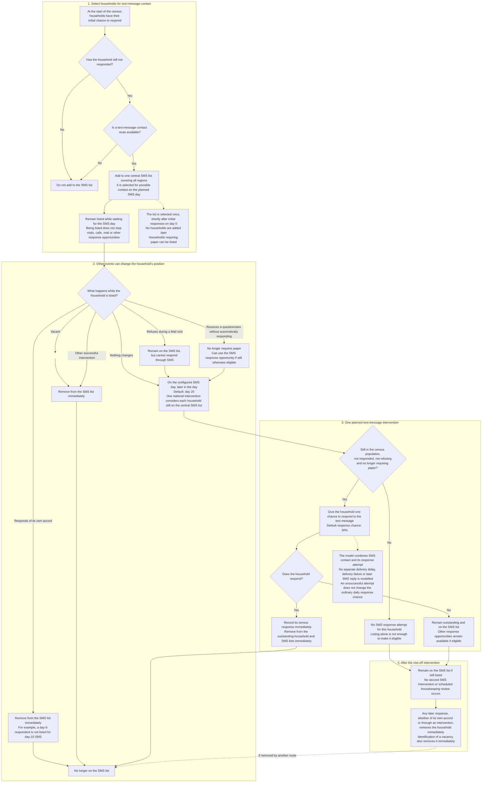

# SMS Intervention: The Household Journey

This chart shows how the current model selects households for text-message
contact, checks whether they can respond and removes them from the SMS list.
Being on the list does not guarantee an SMS response opportunity.

**Terms:** outstanding means not yet responded. A household remains in the
census population unless identified as vacant. Requiring paper prevents an SMS
response until a questionnaire has arrived; merely ordering it is not enough.

Selection occurs at day 0 + 0.1; the intervention at the configured day + 0.85;
there is no delayed cleanup. These offsets indicate simulation order, not
real clock times. Other events can occur between these stages, and eligibility
is checked using the household's state at the time of the intervention.

Sources: [SMS selection and intervention](../functions/functions_sms.py),
[process registration](../functions/function_core.py),
[ordinary responses](../functions/functions_households.py),
[field responses and vacancy removal](../functions/functions_field.py), and
[reminder responses](../functions/functions_reminder_letters.py).
